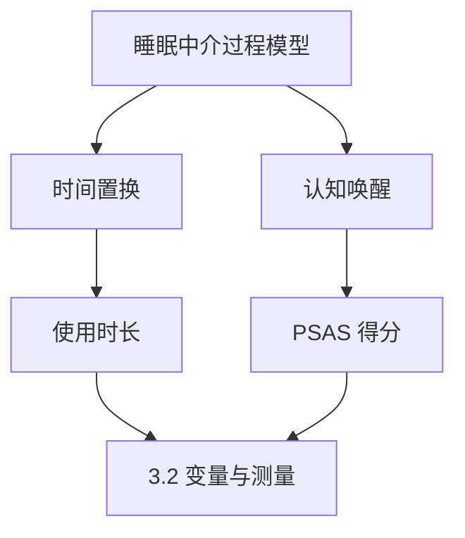

# 论文决策记录

一份论文仓库里维护两个文件，职责不同：

| 文件 | 性质 | 何时变 |
|---|---|---|
| `decisions.md` | **只追加**的决策日志 | 每次裁定后追加一条；推翻旧裁定则回改旧条目状态 |
| `theory-map.md` | **活文档**的结构映射 | 理论、构念、变量或章节归属变化时更新 |

放仓库根目录；若仓库已有 `docs/` 且文档都放在那里，则放 `docs/`。**先看仓库结构定一次，之后不再移动**——路径一变，旧记录就找不到了。

## 核心是"读"，不是"写"

记录本身没有价值，价值在于修改前先读：

1. **动手前**：读 `decisions.md` 里与本次修改相关的已定条目，读 `theory-map.md` 里相关的构念与章节归属。
2. **判定**：本次修改是否与既有裁定冲突？是否有条目会被推翻？
3. **冲突先问**：若与已定裁定互斥，先说明"这条与 D-0xx 冲突，两者不能并存"，让用户决定以哪条为准，不要自行二选一。
4. **改完追加**：追加一条决策；若推翻旧条目，把旧条目的状态改为"已推翻（被 D-0xx 推翻）"，不要删除。

漏记比记错更常见。宁可条目短，也要在每次结构改动、每次采纳或拒绝用户意见后留痕。

## 决策条目格式

追加到 `decisions.md` 末尾，字段固定，缺项写"未定"：

~~~markdown
## D-012 摘要是否把"客/容"升为正论

- 日期：2026-11-22
- 类型：结构
- 触发：用户意见（导师说摘要与引言对不上）
- 候选：① 保持两处正论 ② 升为三处正论 ③ 砍掉若谷句
- 判据：论证负担 / 与研究史的衔接 / 可检验性
- 裁定：②
- 理由：三处差异同属"领起句＋比喻句群"，合观才构成章级问题；只论两处则系统性无从体现
- 影响：摘要、引言一、研究史收束句
- 状态：已定
~~~

字段说明：

- **类型**：结构 / 论证 / 理论框架 / 文献取舍 / 语言与体例 / 投稿
- **触发**：用户意见 / 审稿意见 / 自查发现 / 模型自行调整（四种都要记，最后一种尤其要记，否则用户不知道你动过什么）
- **候选**：至少两个；只有一个方案时写"无替代方案"并说明为什么
- **判据**：这一条最容易被跳过，也最有价值——半年后你只会记得裁定，不会记得当时按什么标准判的
- **影响**：写明涉及的章节、图表、结论，供后续检索
- **状态**：已定 / 待定 / 已推翻（被 D-0xx 推翻）

## 文献取舍

文献决定同样进 `decisions.md`，用"类型：文献取舍"，并在"理由"里落到具体判据，不要写"不够相关"：

- 检索命中但未采用：写清是范围、方法、数据、质量还是语言的问题
- 两篇结论冲突时的取舍：写清你信哪一篇、凭什么
- 综述里被省略的经典：写清是有意省略还是待补
- 被审稿人要求补充而找不到的：写清检索式与已查数据库，便于答辩时说明

答辩与审稿最常见的追问是"为什么没引某某"，一条记录就能回答。

## 理论结构映射

`theory-map.md` 用三段式，同一份内容写两遍：表格给人查，mermaid 给 Typora / Obsidian / GitHub 画。

**注意：DSH 聊天界面不渲染 mermaid，只会显示成代码块。** 在聊天里回答时用表格或缩进大纲；mermaid 块写进文件即可。

~~~markdown
## 理论 → 构念 → 操作化

| 理论 | 构念 | 操作化 | 章节 | 检验方式 |
|---|---|---|---|---|
| 睡眠中介过程模型 | 时间置换 | 社交媒体使用时长 | 3.2 | 分层回归 |
| 睡眠中介过程模型 | 认知唤醒 | PSAS 得分 | 3.2 | Bootstrap 中介 |
| 补偿性网络使用 | 使用动机 | 自编量表 | 2.3 | 未检验（局限） |

## 结构图

## 未落地的理论

- 计划行为理论：引言提及但未进入模型，须在局限中说明
~~~

"未落地的理论"这一段是冲突检查的主要来源：引言承诺了、模型里没有，是最常见的审稿意见。

## 冲突检查

用户要求"看看有没有逻辑冲突"，或在较大改动前自查时，按此程序走，不要凭印象：

1. 取 `decisions.md` 中状态为"已定"的条目，把每条裁定压缩成一个可检验的命题。
2. 与三处对照：摘要与引言中的承诺、假设与模型中的路径、结论与讨论中的表述。
3. 分三类报告：
   - **互斥**：两处不能同时成立（例：摘要说"三处差异同向"，正文只论两处）
   - **张力**：可以并存但需说明（例：引言用了某理论，模型未检验）
   - **无冲突**
4. 每条冲突给出：位置、两处原文、为什么互斥、建议以哪一处为准。
5. 不要替用户改，先报清单；用户确认后再动。

## 边界

- 记录**决策与理由**，不记录模型的内部推理过程。推理不可复核，记录只会变成噪音。
- 不要在 `decisions.md` 里复制正文。引用位置（章节号、行号）即可，正文改了记录不必跟着改。
- 条目一旦写下，只改状态，不改理由。理由要改，说明当时判错了，另开一条说明为什么推翻。
- 本技能不授权修改论文正文；用户要求改时再改。
